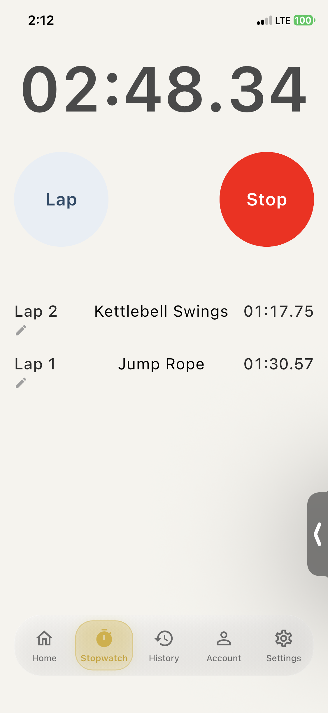
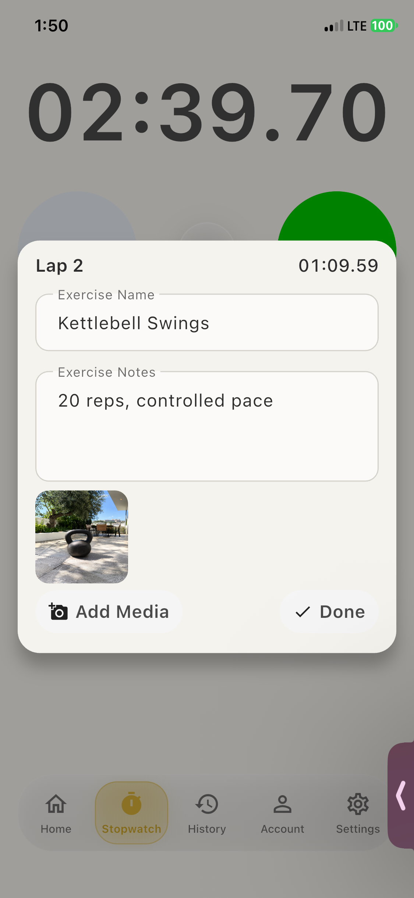
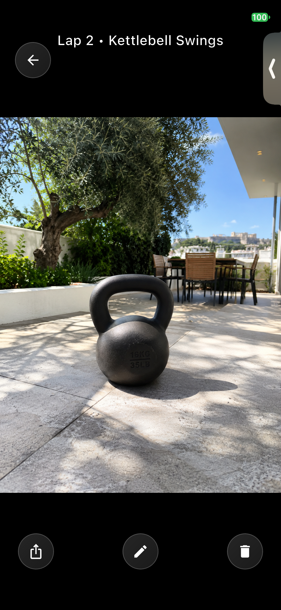
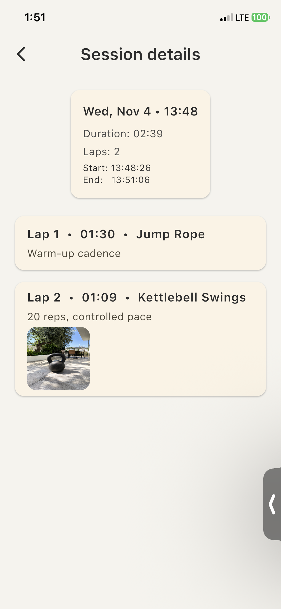
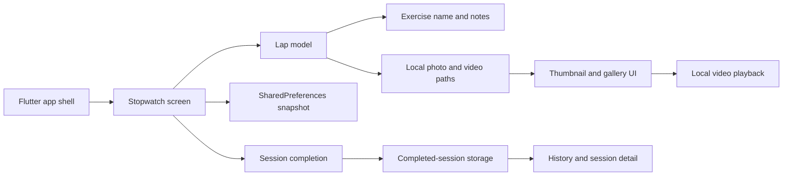

# InterBall

InterBall is an iOS-focused Flutter prototype for documenting interval-based activities. It connects each timed segment with a label, notes, photos, and videos so the result is more useful than a list of timestamps.

> **Project status:** Private-source prototype. Revision `da96781` passes static analysis and two automated smoke tests, launches successfully on a physical iPhone after its `UIScene` migration, and completed the scripted device workflow twice. This repository is intended as a public, source-free project showcase.

## Demo

[Watch the 66-second InterBall workflow demonstration](media/interball-demo-2x.mp4) — captured on an iPhone 11 Pro and presented at 2× speed without audio.

<table>
  <tr>
    <td width="50%" align="center"></td>
    <td width="50%" align="center"></td>
  </tr>
  <tr>
    <td align="center"><strong>Live interval session</strong></td>
    <td align="center"><strong>Lap context and media</strong></td>
  </tr>
  <tr>
    <td width="50%" align="center"></td>
    <td width="50%" align="center"></td>
  </tr>
  <tr>
    <td align="center"><strong>Full-screen media review</strong></td>
    <td align="center"><strong>Saved workout history</strong></td>
  </tr>
</table>

## Why it exists

Most interval timers preserve timestamps but lose the context around them. InterBall explores a lap-centered session record where time, activity details, observations, and captured media remain connected.

The current prototype uses interval training as its initial domain and its most visually direct demonstration. The underlying record is intentionally broader: the same interval model can describe a workout set, an MCAT practice block, a skill drill, a lab step, or another timed activity that benefits from categorization and later review.

## Current prototype scope

The private application source currently contains implementations for:

- Starting, stopping, resetting, and dividing a stopwatch into laps
- Live lap timing and lap-level exercise names and notes
- Camera-based photo and video capture
- Copying captured media into application-local storage
- Per-lap media thumbnails and drag reordering
- Full-screen, swipeable media review and deletion
- Local video playback with seeking, mute, and filmstrip-style scrubbing
- Session completion with a title, notes, tags, and session media
- Saving completed sessions and reviewing lap details in History
- Serialized active-session snapshots using `SharedPreferences`

These are validated prototype capabilities, not a claim of release readiness. Static analysis reports no errors, two smoke tests pass, and the record/save/History workflow completed twice on an iPhone 11 Pro. The final capture revision is `da96781`.

The current UI still uses fitness-oriented labels such as “Exercise Name” because training is the first product wedge. Generalized activity terminology, richer categorization, and portable or shareable session records are product direction rather than claims about the demonstrated build.

## Deliberately excluded from the demo

- **Saved image annotation:** the current screen previews text over an image but does not render that text into a new image file.
- **Home, Account, and Settings experiences:** these remain placeholders. History has an implemented session list and detail path.
- **Apple Watch functionality:** watch targets exist as scaffold code, but no working watch feature is claimed.
- **Production-grade restoration guarantees:** the demonstrated relaunch path works, while broader lifecycle and migration edge cases still need coverage.
- **iCloud synchronization:** an experimental service exists, but it is not part of the verified demo scope.
- **Export and generalized sharing:** these are future product directions, not demonstrated capabilities.
- **Production or App Store readiness:** the project is an active prototype.

## Architecture at a glance

The V2 implementation delegates UI and data work into feature widgets, models, and storage helpers while the stopwatch screen remains the workflow coordinator. Further separation of timing, lifecycle, and media orchestration is planned.

## Technology

- Flutter and Dart
- Material 3
- `image_picker` for camera capture
- `path_provider` for application-local file storage
- `shared_preferences` for prototype session snapshots
- `video_thumbnail` for previews
- `video_player` for local playback
- iOS 15 minimum target in the current native configuration

## Demonstrated workflow

The public demo follows this validated path:

1. Open directly into the stopwatch tab.
2. Start a session and create two laps.
3. Add an exercise name and short note to a lap.
4. Capture and attach media on an iPhone.
5. Stop, complete, and save the session.
6. Open History and review the saved lap details.
7. Open the media gallery and demonstrate video playback controls.

## Engineering status

| Area | Current evidence | Status |
|---|---|---|
| Stopwatch and laps | Implemented in the modular V2 screen | Validated on physical iPhone |
| Lap names and notes | Implemented in lap editor UI | Validated on physical iPhone |
| Photo/video capture | Camera and library paths with local storage | Validated on physical iPhone |
| Media gallery | Reorder, swipe, delete, and playback code | Core review path validated on physical iPhone |
| Session completion and History | Save, list, and detail paths | Validated on physical iPhone |
| Active-session persistence | Offset-based save/load code | Relaunch behavior validated in scripted workflow |
| Automated tests | App/stopwatch/History smoke tests | 2 tests passed on the developer Mac |
| Navigation | Branded five-tab shell; Stopwatch and History are active | Home, Account, and Settings are placeholders |
| Image annotation | Visual overlay preview only | Not demo-ready |

## Documentation

- [Product overview](docs/product-overview.md)
- [Technical overview](docs/technical-overview.md)
- [Validation summary](docs/validation.md)

## Source policy

InterBall is independently developed by Oscar Lock. Its application source and private development history remain in a separate private repository. This showcase contains product documentation and approved demonstration media only.

## Contact

- [GitHub](https://github.com/oscarlock)
- [LinkedIn](https://www.linkedin.com/in/oscarlock/)

Copyright (c) 2024–2026 Oscar Lock. All rights reserved.
