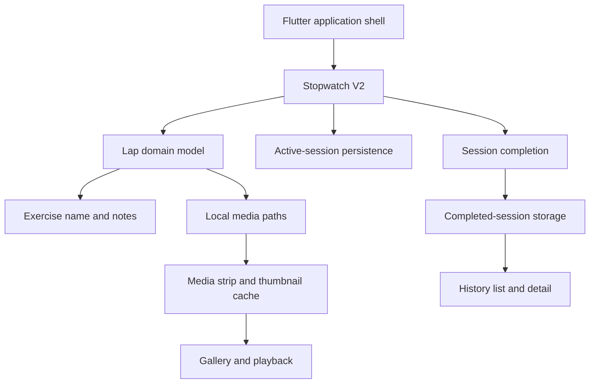

# Technical Overview

## Stack

- Flutter and Dart
- Material 3
- iOS 15 minimum target
- `image_picker` for camera and library access
- `path_provider` for application-local media storage
- `shared_preferences` for prototype state and session persistence
- `video_thumbnail` for media previews
- `video_player` for local playback

## Current architecture

The V2 screen coordinates the active workflow while domain models, storage helpers, and reusable presentation widgets isolate significant responsibilities. The central domain primitive is a timed lap with optional descriptive and media context; the current presentation names that context in fitness terms. The codebase also retains some legacy widgets during the transition to the feature-based structure.

## Timing and persistence

Dart `Stopwatch` and periodic timer primitives drive the live display and lap durations. Active state is persisted locally with an elapsed-time offset so an interrupted session can be restored. Completed sessions use JSON serialization and normalize media paths so locally stored files remain addressable across container-path changes.

## Media pipeline

Photos and videos are selected through the device camera or library and copied into application-local documents storage. Each lap owns an ordered list of paths. Video thumbnails are generated and cached; the gallery supports swipe navigation, deletion, local playback, seeking, mute, and filmstrip-style scrubbing.

## iOS integration

The application uses Flutter's `UIScene` lifecycle and registers its native iOS text-field platform view through `FlutterImplicitEngineDelegate`. Camera, microphone, photo-library, Bonjour, and local-network usage descriptions are configured in the iOS application metadata.

## Current constraints

- Home, Account, and Settings are placeholders.
- Broader activity categories and export/share workflows are product direction rather than implemented showcase features.
- Saved image annotation is not part of the active validated workflow.
- Experimental iCloud code is not presented as a production sync feature.
- Lifecycle, permission-denial, migration, and media-failure coverage should expand before release preparation.
- The private source retains legacy components while the modular architecture is consolidated.

## Planned direction

1. Isolate timer and lifecycle behavior behind a dedicated controller.
2. Replace remaining delimiter-based active-state data with structured, versioned JSON.
3. Complete the transition away from legacy presentation widgets.
4. Expand device, permission, persistence, and media tests.
5. Design or remove the remaining placeholder destinations.
