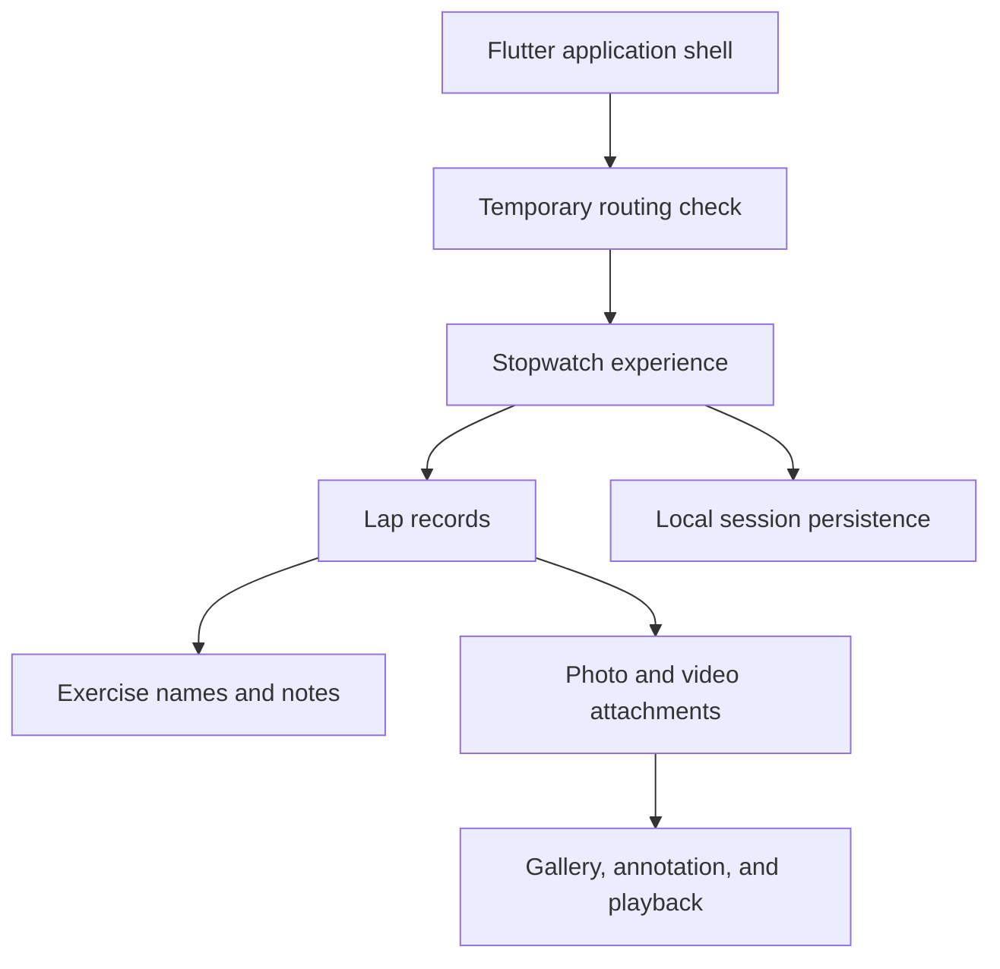

# Technical Overview

## Current implementation

InterBall uses Flutter and Dart for its mobile application layer. The current prototype centers on a stateful stopwatch experience that owns lap timing, lap metadata, local persistence, media capture, media storage, thumbnail generation, and access to the media-review interfaces.

This diagram describes the implemented prototype flow. It is not a claim that every concern has already been separated into an independent production service.

## Timing and lap state

The stopwatch uses Dart timing primitives to update elapsed time and create lap records. Each lap stores its own duration and can be enriched with an exercise name, notes, and an ordered collection of local media paths.

The active interface supports starting, pausing, resetting, and adding laps. Current-lap timing is updated while the stopwatch is running.

## Persistence

SharedPreferences is currently used to persist timer state and serialized lap information locally. The stored information includes elapsed timing state, running state, pause information, lap timing, exercise names, notes, and references to locally stored media.

This approach is appropriate for the current prototype. A later architecture pass may replace the serialized representation with a more structured persistence model as the data and migration requirements become clearer.

## Media pipeline

The current media workflow uses:

- Image Picker for device-camera photo and video capture
- Path Provider for access to application documents storage
- Video Thumbnail for preview generation
- Video Player for local playback and seeking

Captured files are copied into application-local storage and associated with individual lap records. Video previews are generated and cached to reduce repeated thumbnail work during interface rebuilds.

## Media review

The prototype includes:

- Per-lap media thumbnails
- Reordering of attached media
- Full-screen swipeable review
- Image text annotation
- Media deletion with confirmation
- Local video playback
- Seeking and filmstrip-style scrubbing
- Playback and mute controls

## Current engineering constraints

The primary stopwatch implementation currently contains several responsibilities in one large stateful screen. That accelerated feature exploration, but it also creates maintenance and testing pressure. Component extraction and separation of timing, persistence, and media concerns are explicit development priorities.

The application currently launches through a temporary routing-check screen. Navigation and the primary product entry experience are not yet release-ready.

Automated coverage is also at an early stage. Expanding widget, routing, persistence, and media-flow tests is required before release preparation.

## Planned technical direction

The next architecture pass is expected to focus on:

1. Separating stopwatch and lap-domain behavior from presentation code.
2. Isolating persistence behind a dedicated interface.
3. Isolating media capture, storage, thumbnail, and playback coordination.
4. Dividing the primary interface into smaller testable widgets.
5. Establishing repeatable routing and state-restoration tests.
6. Validating lifecycle and permission behavior on physical iOS devices.

These items describe planned work and should not be interpreted as already implemented architecture.

## Source policy

The application source code and private commit history are not included in this public repository. This technical overview intentionally describes behavior and engineering decisions at a high level without publishing proprietary implementation details.
